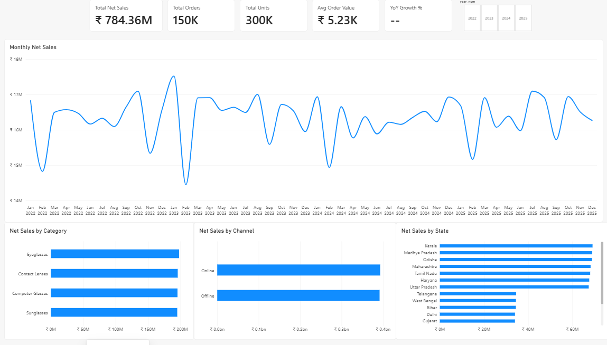
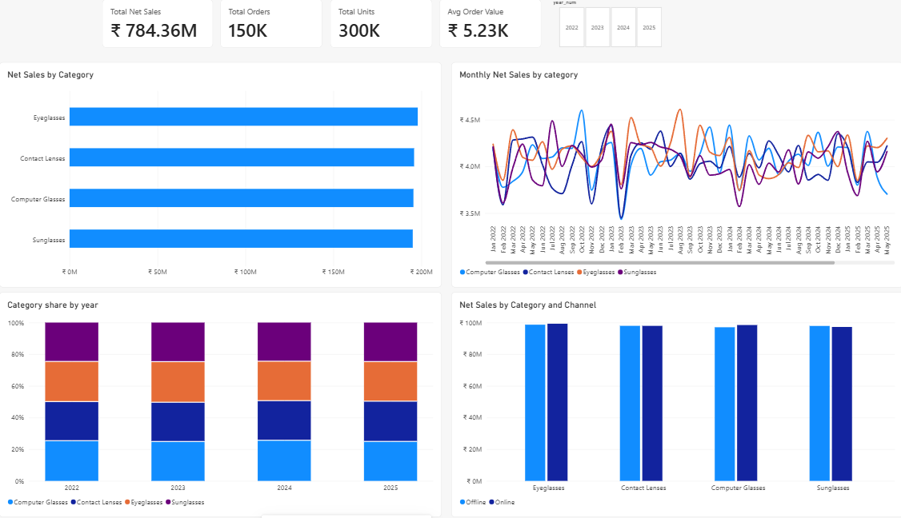
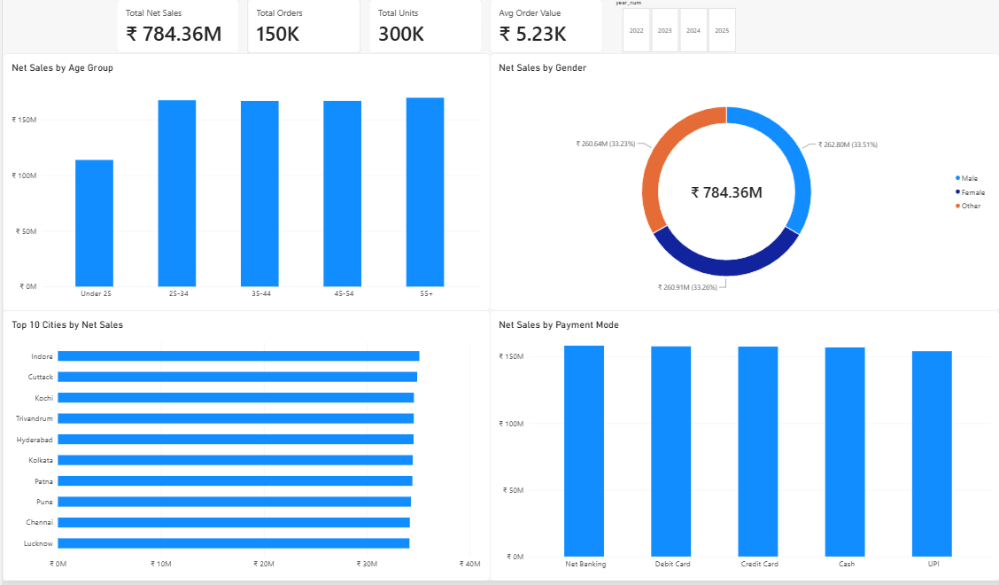

# Lenskart: Eyewear E-commerce & Customer Trends
### End-to-end data analytics project using MySQL and Power BI
**Author:** Manjiri Ghate

## Overview
An interactive 3-page Power BI dashboard analysing 150,000 eyewear
retail transactions (2022–2025), covering sales trends, product
performance and customer behaviour. Data was cleaned and modelled in
MySQL, then visualised in Power BI using DAX measures.

## Dataset
- Source: Lenskart India Sales & Customer Analytics Dataset
  (Kaggle, by DataMonkResearch), licence CC BY-SA 4.0
- 150,000 rows, 2022–2025
- Note: this is a simulated dataset inspired by the Indian eyewear
  market. It does not represent real Lenskart transactions.

## Tools
- MySQL + MySQL Workbench (macOS) – data storage, cleaning, modelling
- Power BI Desktop (Windows) – data model, DAX, dashboard

## Workflow
1. Imported the raw CSV into MySQL (raw_sales)
2. Checked row counts, nulls and duplicates
3. Built a star schema: fact_sales + dim_date, dim_product_category,
   dim_channel, dim_location, dim_payment
4. Exported tables to CSV and loaded them into Power BI
5. Created relationships and DAX measures (Total Net Sales, Total
   Orders, Avg Order Value, YoY Growth %, Repeat Purchase Rate)
6. Built three report pages

## Dashboard pages
1. Sales Overview – KPIs, monthly trend, sales by category/channel/state
2. Product & Category Trends – category comparison, share by year,
   category x channel
3. Customer Trends – age group, gender, top cities, payment mode

## Key insights
- Net sales are flat at ~₹195–197M per year (growth within ±1.2%)
- February is the lowest month in every year
- Four product categories are balanced at ~25% each
- Under-25 customers contribute 14.5% of sales, about a third less
  than every other age group
- Payment modes (~20% each) and channels (~50/50) are evenly split

## Limitations
- Synthetic data: segments are evenly distributed, so differences
  are small
- No cost data, so profit cannot be calculated
- Project demonstrates the method, not real business findings

## Future improvements
- Add cost/margin data for profitability analysis
- Customer retention (cohort) analysis
- Publish to Power BI Service for sharing
